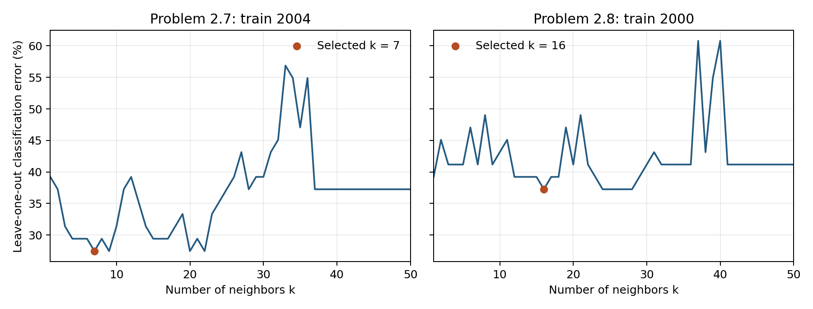

# Homework 1 — Problems 2.7 and 2.8

Both original datasets contain 50 states plus DC (51 observations). Obesity percentage is the sole predictor; supplied R/D labels and original row order are retained.

## Method

The classifier is scikit-learn's standard KNeighborsClassifier with default uniform weights and all other estimator settings at their defaults. LeaveOneOut evaluates k = 1,…,50 using the training year only: each fit uses exactly 50 observations and predicts the held-out observation. Among tied minimum LOOCV errors, the smallest k is selected as an implementation convention. The selected classifier is fitted on all 51 training observations; test labels are used only for scoring.

## Results

| Problem | Training → test | Selected k | LOOCV error | Test error |
|---|---|---:|---:|---:|
| 2.7 | 2004 → 2000 | 7 | 14/51 (27.45%) | 27/51 (52.94%) |
| 2.8 | 2000 → 2004 | 16 | 19/51 (37.25%) | 19/51 (37.25%) |

Problem 2.7: all minimizing k values are 7, 9, 20, 22.

Problem 2.8: all minimizing k values are 16, 24, 25, 26, 27, 28.



## Discussion

Within-year LOOCV error is lower than cross-year test error in Problem 2.7. Problem 2.8 has equal LOOCV and test error. Always predicting the training majority class (R) gives test errors of 21/51 (41.18%) and 19/51 (37.25%), respectively: the selected model is worse than this baseline in Problem 2.7 and matches it in Problem 2.8. Identical obesity values can have opposite labels, and changes across years limit prediction from this sole predictor. These tests evaluate transfer across years for the same jurisdictions. Minimum LOOCV error is used for selection and is not an independent post-selection estimate.

## Reproduction

Checked with Python 3.13.14 and scikit-learn 1.9.1.

```sh
python3 -m venv .venv
.venv/bin/python -m pip install -r requirements-lock.txt
.venv/bin/python solve_classification.py
.venv/bin/python -m unittest -v test_classification.py
```

All 100 LOOCV counts and all 102 selected-model test predictions are checked against separately computed sklearn reference outputs. Checks also confirm that changing test labels cannot change model selection or predictions. Original input hashes are checked before and after the run.
