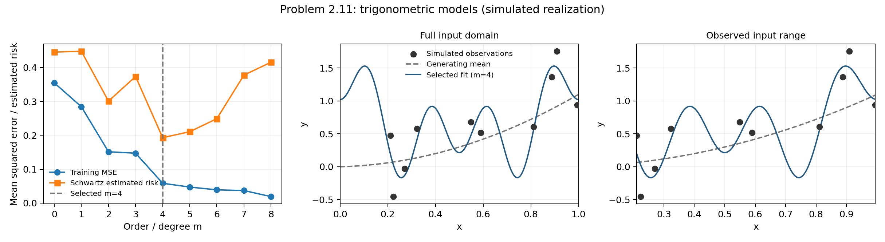
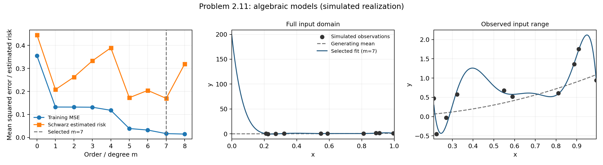
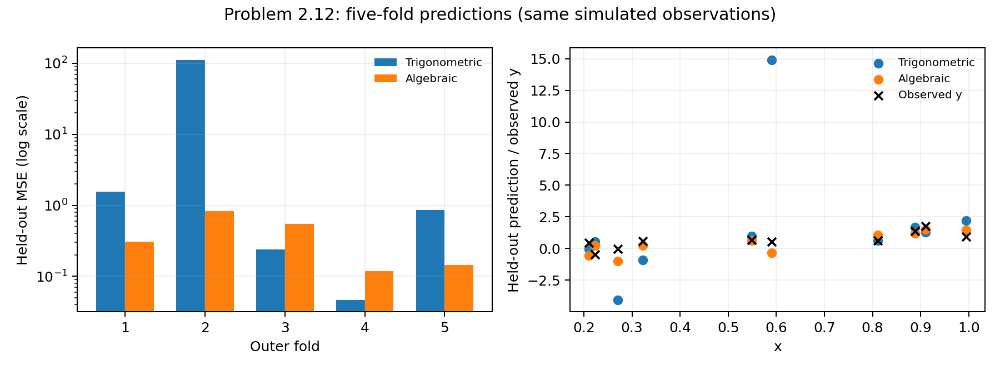

# Homework 1 — Problems 2.11 and 2.12

Since the homework specifies the data-generating process but does not provide the numerical realization, a reproducible n = 10 realization was generated with random seed 20261006 and reused in Problems 2.11 and 2.12.

Dataset: n = 10, x ~ Uniform[0,1], y = x² + 0.1x + ε, ε ~ N(0,0.25). Noise standard deviation is 0.5. NumPy Generator(PCG64), seed 20261006, draws all ten x values first and then ten independent noise values. The saved `results/example_2_6_simulated.csv` is reused unchanged for both problems and on subsequent runs.

## Course criterion and fitting

The supplied course-specific equation is used directly:

$$p=\frac{\mathrm{DoF}}{n},\qquad r(p,n)=1+\frac{p}{1-p}\ln n,\qquad \widehat R=r(p,n)R_{\mathrm{emp}},\qquad R_{\mathrm{emp}}=\frac1n\sum_{j=1}^n(y_j-\widehat f(x_j))^2.$$

Both families have DoF = m + 1. The trigonometric model contains only an intercept and cos(2πix), i = 1,…,m; no sine terms are added. Algebraic models span 1,x,…,x^m. Fits use SVD-based NumPy least squares. Algebraic fitting uses Legendre polynomials of 2x−1, an equivalent basis of the same degree-m polynomial space, to improve conditioning. Reported assignment-basis coefficients are converted back to powers of x; predictions use the stable fitting basis. No regularization or generic BIC is used. An exactly tied estimated risk is resolved by choosing the smallest m.

## Problem 2.11

With n = 10, admissible models have m = 0,…,8 and DoF < 10. The following tables report every candidate.

### Trigonometric

| m | DoF | Training MSE R_emp | Multiplier r(p,10) | Estimated risk R_hat |
|---:|---:|---:|---:|---:|
| 0 | 1 | 0.354725684 | 1.25584279 | 0.445479692 |
| 1 | 2 | 0.284174858 | 1.57564627 | 0.447759056 |
| 2 | 3 | 0.151406848 | 1.98682218 | 0.300818485 |
| 3 | 4 | 0.147274477 | 2.53505673 | 0.373349155 |
| 4 | 5 | 0.0584411323 | 3.30258509 | 0.193006812 |
| 5 | 6 | 0.0472923912 | 4.45387764 | 0.210634524 |
| 6 | 7 | 0.0390812328 | 6.37269855 | 0.249052915 |
| 7 | 8 | 0.0369839102 | 10.2103404 | 0.377618312 |
| 8 | 9 | 0.0191278767 | 21.7232658 | 0.41551995 |

Selected m = **4**, DoF = 5, estimated risk = 0.193006812.



### Algebraic

| m | DoF | Training MSE R_emp | Multiplier r(p,10) | Estimated risk R_hat |
|---:|---:|---:|---:|---:|
| 0 | 1 | 0.354725684 | 1.25584279 | 0.445479692 |
| 1 | 2 | 0.132196508 | 1.57564627 | 0.208294935 |
| 2 | 3 | 0.132006398 | 1.98682218 | 0.262273239 |
| 3 | 4 | 0.131411851 | 2.53505673 | 0.333136497 |
| 4 | 5 | 0.117993068 | 3.30258509 | 0.389682149 |
| 5 | 6 | 0.0387801304 | 4.45387764 | 0.172721956 |
| 6 | 7 | 0.0320908112 | 6.37269855 | 0.204505066 |
| 7 | 8 | 0.016643211 | 10.2103404 | 0.169932849 |
| 8 | 9 | 0.0147090214 | 21.7232658 | 0.319527983 |

Selected m = **7**, DoF = 8, estimated risk = 0.169932849.



The minimum Schwartz values can be compared as estimates under the supplied criterion, but two within-family selections alone do not establish which family has the lowest true predictive risk. Selection uses the same small training dataset, and the risk estimates depend on the criterion's assumptions. Independent predictive evaluation is needed to support a family comparison; Problem 2.12 supplies held-out predictions.

## Problem 2.12

A separate PCG64 generator with seed 212 permutes sample IDs 0,…,9 and groups consecutive pairs into five outer folds. Both families use exactly the same folds. For every fold, only the eight training observations are used to select m = 0,…,6, using n = 8 and DoF = m + 1 < 8. The selected fit predicts the two held-out observations. All ten squared prediction errors are pooled to obtain CV MSE; since fold sizes are equal, this also equals the mean of the five fold MSEs.

| Fold | Held-out IDs | Trig. selected m | Trig. fold MSE | Alg. selected m | Alg. fold MSE |
|---:|---|---:|---:|---:|---:|
| 1 | 3, 1 | 6 | 1.5558834 | 5 | 0.308201261 |
| 2 | 7, 6 | 6 | 111.460273 | 6 | 0.829983231 |
| 3 | 9, 5 | 6 | 0.238543171 | 5 | 0.546663455 |
| 4 | 8, 0 | 4 | 0.0468218433 | 1 | 0.119016043 |
| 5 | 2, 4 | 2 | 0.86050292 | 1 | 0.144008041 |

| Family | Five-fold CV MSE |
|---|---:|
| Trigonometric | 22.8324048 |
| Algebraic | 0.389574406 |

**Algebraic models perform better on this realization and fold partition**, with CV MSE lower by 22.4428304. This evaluates each family's complete Schwartz-selection procedure rather than a degree chosen using all ten observations. The folds were fixed before looking at predictive errors. No outer held-out observation was used to fit or select a model within its fold; the pooled held-out errors are used to compare the families.



## Validation and limitations

Independent checks compare the multiplier to 1 + DoF·ln(n)/(n−DoF), recompute all candidate fits by QR in a separate polynomial basis, verify held-out predictions and pooled errors, check DoF and rank, and change held-out labels to confirm the corresponding fold's selection cannot change. Every sample is held out once per family and both families use identical training/test fold IDs.

This comparison is based on one simulated dataset of ten observations and one five-fold partition. Fold errors and selected orders can vary with the realization or partition; this result does not establish universal superiority or statistical significance. High-order fits may be numerically sensitive and unstable between samples; saved candidate tables include matrix rank and condition number. The course multiplier is undefined at DoF = n, so those models are excluded rather than evaluated.

The large trigonometric CV error is dominated by fold 2 (fold MSE 111.460273): the prediction for sample 6 is approximately 14.8994, compared with observed y = 0.520865. Independent QR checks reproduce this result. The algebraic full-data m = 7 fit also exhibits a large boundary excursion near x = 0, outside the observed input range (approximately 0.211–0.994). The figures show both the full domain and a separate view of the observed range. CV here assesses held-out observations at their sampled locations and does not establish reliable behavior everywhere on [0,1]. Furthermore, every specified cosine-only model satisfies f(x) = f(1−x), whereas the generating mean x² + 0.1x does not; the two families therefore have different approximation limitations.

## Reproduction and saved results

Use the existing environment and dependency lockfile:

```sh
.venv/bin/python solve_regression.py
.venv/bin/python -m unittest -v test_regression.py
```

CSV tables contain full-precision values; report tables are rounded for display. JSON includes seeds, versions, dataset hash, all candidate fits, stable-basis and assignment-basis coefficients, selected models, folds, and held-out predictions. PNG/SVG/PDF figures accompany the tables. Original PDF/CSV files and all classification results are preserved.

Created files:

- `solve_regression.py`, `test_regression.py`, `regression_report.md`
- `results/example_2_6_simulated.csv`
- `results/problem_2_11_trigonometric.csv`, `results/problem_2_11_algebraic.csv`
- `results/problem_2_12_candidates.csv`, `results/problem_2_12_folds.csv`, `results/problem_2_12_predictions.csv`
- `results/regression_summary.csv`, `results/regression_results.json`, `results/regression_validation.txt`
- `results/problem_2_11_trigonometric.png`, `.svg`, `.pdf`
- `results/problem_2_11_algebraic.png`, `.svg`, `.pdf`
- `results/problem_2_12_cv.png`, `.svg`, `.pdf`
