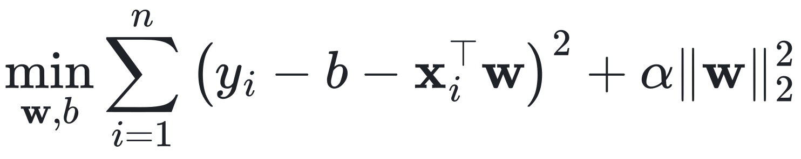
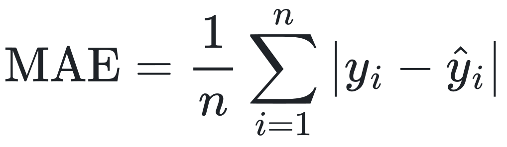
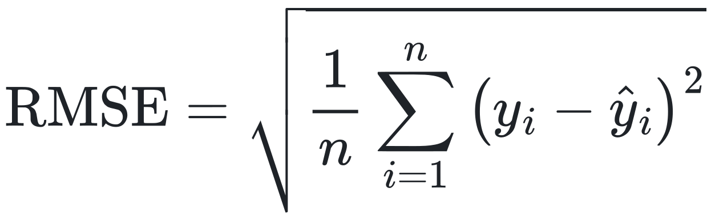

::: {.cover}
::: {.bar}
:::
::: {.kicker}
MIDTERM RESEARCH PROPOSAL
:::

<h1>Impact of Weather Information Availability on One-Hour-Ahead Bike-Sharing Demand Forecasting: A Cross-Model Study</h1>

::: {.course}
Predictive Learning
:::
::: {.inst}
Department of Computer Science and Information Engineering<br>National Taiwan Normal University<br>October 27, 2026
:::
::: {.members}
Group Members: [Member A] · [Member B] · [Member C] · [Member D]
:::
:::

## Research Background and Motivation

::: {.claim}
Weather is a recognized driver of bike-sharing use, but a **forecast** can only use weather that is already known.
:::

::: {.columns}
::: {.column width="33%"}
**Demand depends on weather**

::: {.small}
Cold, rain and high humidity are associated with fewer and shorter bikeshare trips (Gebhart & Noland, 2014). Weather and temporal factors recur across the bike-sharing literature (Eren & Uz, 2020).
:::
:::
::: {.column width="33%"}
**Seoul hourly data is public**

::: {.small}
The Seoul Bike Sharing Demand data pairs hourly rental counts with weather and calendar fields, and has been used for weather-based demand prediction (Sathishkumar & Cho, 2020).
:::
:::
::: {.column width="33%"}
**Evaluation must match use**

::: {.small}
Hourly forecasts are made at a forecast origin and applied to later months. Which weather is available, and how flexible the model is, should be judged out of time.
:::
:::
:::

::: {.cite}
Scope: system-wide hourly rental counts only; no station, return-flow or inventory data, so no rebalancing claims.
:::

## Research Problem and Forecasting Scenario

::: {.claim}
Which information is available at the **forecast origin**, and how complex should the model be?
:::

- **Target:** system-wide Rented Bike Count in the target hour (rentals per hour)
- **Forecast origin:** end of the previous hour; only earlier observations may be used
- **Protocol:** rolling one-step forecasts; model parameters stay frozen during testing

::: {.columns}
::: {.column width="33%"}
**P1 Information availability**

::: {.small}
Is previous-hour observed weather useful? How much does target-hour actual weather change the picture?
:::
:::
::: {.column width="33%"}
**P2 Model complexity**

::: {.small}
How do regularization and flexibility affect generalization from winter–spring training to later months?
:::
:::
::: {.column width="33%"}
**P3 Attribution and errors**

::: {.small}
What do demand history, time, calendar and weather each add, and when do forecasts fail?
:::
:::
:::

## Related Work: Bike-Sharing Demand Forecasting

| Study | Setting | What it contributes |
|--|----|-------|
| Eren & Uz (2020) | Review of station-based bike-sharing research | Organizes factors behind demand: weather, built environment, public transport, socio-demographics, temporal and safety factors. |
| Sathishkumar & Cho (2020) | Seoul hourly rentals with weather data | Weather-based, rule-based model for Seoul bike demand prediction; this line of work uses the Seoul Bike dataset adopted here. |
| Xin (2026) | Seoul and Washington, DC; one-hour-ahead | Probabilistic forecasting with Transformer-based and other models; reports point error and 80% interval coverage. |

::: {.claim}
Prior work links weather to demand and forecasts Seoul hourly demand with learned models.
:::

::: {.cite}
Sources: see References (slide 14). Descriptions summarize each work's stated scope.
:::

## Related Work: Weather Information and Predictive Models

::: {.columns}
::: {.column width="46%"}
**Weather evidence**

::: {.small}
- Gebhart & Noland (2014), Washington, DC: cold temperature, rain and high humidity reduce both the likelihood and duration of bikeshare trips.
- Eren & Uz (2020): weather is one of several factor groups studied for demand.
- Sathishkumar & Cho (2020): weather variables used for Seoul demand prediction.
:::
:::
::: {.column width="54%"}
**Predictive models: Xin (2026), Seoul, one hour ahead**

| Model | MAE (rentals/h) | 80% coverage |
|---|---:|---:|
| N-BEATS | 115.07 | 75.42% |
| Random Forest | 115.86 | 89.26% |
| TFT | 306.98 | 81.11% |
| Transformer | 317.72 | 74.01% |

::: {.cite}
Reported by Xin (2026), Table 2 (p. 6). Not our results and not directly comparable to ours.
:::

::: {.claim}
Lowest point error does not imply the best interval coverage.
:::
:::
:::

::: {.small}
Open point: the literature does not specify, field by field, which weather values exist at the forecast origin of a one-hour-ahead forecast.
:::

## Research Gap and Proposed Contribution

| Insufficiently clarified question | What prior work leaves open | Our contribution |
|--|-----|-----|
| Information timing | Xin (2026) describes target-time covariates; availability of each field at the forecast origin is not fully specified (not an allegation of leakage). | Explicit E1 / E2 / E3 information settings under one protocol |
| Complexity control | Models from different families are compared; controlled complexity curves are not the focus. | Ridge α, KNN k and tree-depth curves with train vs. validation error (X2, X3) |
| Information value | Which input group matters, and where errors concentrate, is not isolated. | Group ablation and temporal error slices (X4, X5) |

::: {.small}
**Shared with Xin (2026):** date boundaries of the chronological split. **Different:** five weather variables and three demand lags, a 168-hour warm-up, and the definition of eligible samples.
:::

::: {.claim .warn}
**Not claimed:** the first weather study, any leakage in prior work, or superiority over probabilistic methods.
:::

## Research Aim and Research Questions

::: {.claim}
**Aim:** separate the value of *available* weather information from retrospective information, and study model complexity under out-of-time evaluation.
:::

| | Research question | Objective | Falsifiable hypothesis | Analyses |
|--|--------|----|--------|---|
| RQ1 | Does previous-hour observed weather improve next-hour forecasts, and how does target-hour actual weather differ? | Quantify E1 vs. E2 vs. E3 | E2 may beat E1; E3 may help precipitation hours but is not guaranteed to beat E2. | X1, X4, X5 |
| RQ2 | How do model complexity and regularization affect out-of-time generalization? | Map train vs. validation error | Moderate regularization may help; complex models need not win. | X1, X2, X3 |
| RQ3 | What do demand, time, calendar and weather contribute, and where do models fail? | Attribute value and locate errors | Demand history may add most; peak hours may have larger absolute error. | X4, X5 |

## Dataset, Preprocessing and Chronological Split

::: {.metrics}
::: {.metric}
<span class="num">8,760</span><span class="lab">hourly observations, 14 columns</span>
:::
::: {.metric}
<span class="num">8,297</span><span class="lab">eligible samples</span>
:::
::: {.metric}
<span class="num">4,152</span><span class="lab">training</span>
:::
::: {.metric}
<span class="num">720</span><span class="lab">validation</span>
:::
::: {.metric}
<span class="num">3,425</span><span class="lab">test</span>
:::
:::

```{=html}
<svg viewBox="0 0 1170 100" width="100%">
  <text x="0" y="16" font-size="18" fill="#6b7280">Dec 1–7, 2017: 168-h warm-up</text>
  <rect x="0" y="26" width="22" height="40" fill="#9ca3af"/>
  <rect x="22" y="26" width="560" height="40" fill="#0b5cad"/>
  <rect x="582" y="26" width="96" height="40" fill="#b45309"/>
  <rect x="678" y="26" width="492" height="40" fill="#15803d"/>
  <g font-size="22" font-weight="700" fill="#fff" text-anchor="middle">
    <text x="302" y="54">Train</text><text x="630" y="54">Val</text><text x="924" y="54">Test</text></g>
  <g font-size="18" fill="#6b7280">
    <text x="22" y="92">Dec 8, 2017</text><text x="582" y="92" text-anchor="middle">Jun 1, 2018</text>
    <text x="678" y="92" text-anchor="start">Jul 1</text><text x="1170" y="92" text-anchor="end">Nov 30, 2018</text></g>
</svg>
```

::: {.columns}
::: {.column width="25%"}
**1 Align timestamps**

::: {.small}
Date + Hour become a unique hourly timestamp (Seoul local time); no gaps, no missing cells.
:::
:::
::: {.column width="25%"}
**2 Build lags first**

::: {.small}
`lag_1`, `lag_24` and `lag_168` are shifted on the full hourly axis; non-functioning hours stay as observed history.
:::
:::
::: {.column width="25%"}
**3 Select eligible rows**

::: {.small}
Score only Functioning Day = Yes targets with all lags available: 8,465 operating hours, 8,297 after warm-up.
:::
:::
::: {.column width="25%"}
**4 Fit on train only**

::: {.small}
StandardScaler and encoders are fitted on training rows, then applied to validation and test.
:::
:::
:::

::: {.claim}
**Leakage control:** chronological split, past-only lags, no target-hour demand input.
:::

::: {.cite}
Source: Kaggle, Seoul Bike Sharing Demand Prediction (SeoulBikeData.csv); file checksum identical to the UCI release. Bar length proportional to calendar days.
:::

## Feature Engineering and Information Settings (E1–E3)

```{=html}
<svg viewBox="0 0 1170 300" width="100%">
  <rect x="860" y="0" width="310" height="290" fill="#f3f4f6"/>
  <line x1="860" y1="0" x2="860" y2="290" stroke="#111827" stroke-width="3" stroke-dasharray="7 5"/>
  <image href="eq/t168.svg" x="365" y="8" width="110" height="25"/>
  <image href="eq/t24.svg" x="591" y="8" width="98" height="25"/>
  <image href="eq/t1.svg" x="723" y="8" width="84" height="25"/>
  <text x="1015" y="24" font-size="22" font-weight="700" fill="#15803d" text-anchor="middle">Target hour</text>
  <text x="988" y="52" font-size="18" fill="#6b7280" text-anchor="end">predict</text>
  <image href="eq/yTarget.svg" x="996" y="36" width="30" height="22"/>
  <g font-size="18" fill="#6b7280" text-anchor="middle">
    <text x="420" y="62">last week</text><text x="640" y="62">yesterday</text><text x="765" y="62">last completed</text><text x="765" y="80">hour</text></g>
  <g font-size="22" font-weight="700" fill="#111827"><text x="0" y="112">E1 · 13 features</text><text x="0" y="192">E2 · 18 features</text><text x="0" y="272" fill="#dc2626">E3 · 18 features</text></g>
  <g font-size="18" fill="#6b7280"><text x="0" y="136">No explicit weather</text><text x="0" y="216">Previous-hour observed weather</text><text x="0" y="296">Target-hour weather (oracle)</text></g>
  <line x1="0" y1="152" x2="1170" y2="152" stroke="#e5e7eb"/><line x1="0" y1="232" x2="1170" y2="232" stroke="#e5e7eb"/>
  <g font-size="18" font-weight="600" fill="#fff" text-anchor="middle">
    <rect x="360" y="90" width="120" height="32" rx="5" fill="#0b5cad"/><text x="420" y="112">lag_168</text>
    <rect x="580" y="90" width="120" height="32" rx="5" fill="#0b5cad"/><text x="640" y="112">lag_24</text>
    <rect x="720" y="90" width="90" height="32" rx="5" fill="#0b5cad"/><text x="765" y="112">lag_1</text>
    <rect x="915" y="90" width="200" height="32" rx="5" fill="#6b7280"/><text x="1015" y="112">time + calendar</text>

    <rect x="360" y="170" width="120" height="32" rx="5" fill="#0b5cad"/><text x="420" y="192">lag_168</text>
    <rect x="580" y="170" width="120" height="32" rx="5" fill="#0b5cad"/><text x="640" y="192">lag_24</text>
    <rect x="705" y="170" width="80" height="32" rx="5" fill="#0b5cad"/><text x="745" y="192">lag_1</text>
    <rect x="792" y="170" width="62" height="32" rx="5" fill="#b45309"/><image href="eq/wPrev.svg" x="797" y="176" width="52" height="20"/>
    <rect x="915" y="170" width="200" height="32" rx="5" fill="#6b7280"/><text x="1015" y="192">time + calendar</text>

    <rect x="360" y="250" width="120" height="32" rx="5" fill="#0b5cad"/><text x="420" y="272">lag_168</text>
    <rect x="580" y="250" width="120" height="32" rx="5" fill="#0b5cad"/><text x="640" y="272">lag_24</text>
    <rect x="720" y="250" width="90" height="32" rx="5" fill="#0b5cad"/><text x="765" y="272">lag_1</text>
    <rect x="880" y="250" width="150" height="32" rx="5" fill="#6b7280"/><text x="955" y="272">time + cal.</text>
    <rect x="1042" y="250" width="100" height="32" rx="5" fill="#fff" stroke="#dc2626" stroke-width="3" stroke-dasharray="5 3"/><image href="eq/wTarget.svg" x="1072" y="253" width="40" height="26"/>
  </g>
</svg>
```

| Group | Columns | Encoding | Dim. |
|--|------|---|-|
| **H** Historical demand | `lag_1`, `lag_24`, `lag_168` | StandardScaler | 3 |
| **T** Time | Hour and Weekday of the target hour | sin / cos pairs | 4 |
| **C** Calendar | Season (4 levels), Holiday (2 levels) | One-hot | 6 |
| **W** Weather | Temperature, Humidity, Wind speed, Rainfall, Snowfall | StandardScaler | 5 |

::: {.cite}
E1 = H + T + C. E2 adds the previous-hour weather; E3 replaces it with target-hour weather. E3 is a retrospective oracle, is not deployable, and need not beat E2. Target-hour demand is never an input.
:::

## Experimental Design: X1–X3

| Analysis | Models | E1 | E2 | E3 | Varied or controlled |
|------|----------|:-:|:-:|:-:|----------|
| X1 Model comparison | Ridge, KNN, Random Forest, 3 naive | ● | ● | ● | Model × information setting |
| X2 Ridge regularization | Ridge | ○ | ● | ○ | Penalty α |
| X3 Complexity control | KNN, Decision Tree | – | ● | – | k; max_depth |
| X4 Weather and ablation | Ridge, Random Forest | ● | ● | ● | Setting; removed group |
| X5 Temporal error analysis | Best E2 model by validation | ○ | ● | ○ | Hour, month, day type, rain |

::: {.cite}
X1–X5 are analyses crossed with E1–E3, not eight experiments. ● main · ○ supplementary · – not used
:::

::: {.columns}
::: {.column width="33%"}
**X1 · Model comparison**

::: {.small}
- Does the model ranking change with the information setting?
- Ridge, KNN, Random Forest × E1, E2, E3, plus 3 naive baselines
:::
:::
::: {.column width="33%"}
**X2 · Ridge regularization**

::: {.small}
- How does L2 strength change out-of-time error?
- E2 fixed; 10 log-spaced α; train vs. validation RMSE
:::
:::
::: {.column width="33%"}
**X3 · Complexity control**

::: {.small}
- Does added flexibility only lower training error?
- E2 fixed; KNN k = 1–97; tree max_depth = 2–16, None
:::
:::
:::

**X2 Ridge objective** &nbsp;&nbsp;{height=66 fig-alt="\min_{\mathbf{w},b} \sum_{i=1}^{n} (y_i-b-\mathbf{x}_i^\top\mathbf{w})^2 + \alpha\lVert\mathbf{w}\rVert_2^2"}

## Experimental Design: X4–X5

::: {.columns}
::: {.column width="50%"}
**X4 · Weather information and feature ablation**

::: {.small}
**4a  E1 vs. E2 vs. E3.** Ridge and Random Forest on identical samples.
:::

{height=30 fig-alt="Gain_history = MAE(E1) - MAE(E2)"}\
{height=30 fig-alt="Gap_oracle = MAE(E2) - MAE(E3)"}

::: {.small}
**4b  Group ablation on E2.** Hyperparameters fixed from Full E2; same samples.
:::

| Variant | Removed columns |
|--|-----|
| Full E2 | none (reference) |
| − H | lag_1, lag_24, lag_168 |
| − T | hour and weekday sin / cos |
| − C | season and holiday |
| − W | 5 weather columns (= E1) |

{height=30 fig-alt="DeltaMAE_remove(G) = MAE(-G) - MAE(Full E2)"}
:::
::: {.column width="50%"}
**X5 · Temporal error analysis**

::: {.small}
Pre-specified slices of the test period, for the best E2 model by validation MAE:
:::

| Slice | Definition |
|--|------|
| Hour | MAE for each target hour 0–23; night 00–05, peaks 07–09 and 17–19 |
| Month | July to November 2018 |
| Day type | Weekday vs. weekend; holiday flag |
| Precipitation | Rainfall > 0 or Snowfall > 0 vs. none (scoring label only) |
| Curve | Actual vs. predicted, 2018-07-01 to 2018-07-07 (fixed in advance) |

::: {.small}
Each slice reports n, mean rentals, MAE, RMSE and signed error.
:::

::: {.claim}
Ablation is not a causal intervention.
:::
:::
:::

## Evaluation Protocol, Resources and Project Timeline

::: {.columns}
::: {.column width="58%"}
**Evaluation metrics**

{height=74 fig-alt="MAE = (1/n) sum |y_i - yhat_i|"}&nbsp;&nbsp;&nbsp;&nbsp;{height=95 fig-alt="RMSE = sqrt((1/n) sum (y_i - yhat_i)^2)"}

::: {.small}
- Unit: rentals per hour; predictions clipped at 0
- No MAPE (zero counts); rolling one-step forecasts
:::
:::
::: {.column width="42%"}
**Model selection and leakage control**

::: {.small}
- Validation MAE selects hyperparameters
- Test evaluated once on a pre-registered list
- Scalers fitted on training rows only; no shuffled K-fold
:::
:::
:::

**Project timeline**

```{=html}
<svg viewBox="0 0 1170 150" width="100%">
  <line x1="0" y1="62" x2="1170" y2="62" stroke="#0b5cad" stroke-width="3"/>
  <g fill="#0b5cad"><circle cx="12" cy="62" r="9" fill="#b45309"/><circle cx="179" cy="62" r="9" fill="#b45309"/><circle cx="346" cy="62" r="9"/><circle cx="513" cy="62" r="9"/><circle cx="680" cy="62" r="9"/><circle cx="847" cy="62" r="9"/><circle cx="1014" cy="62" r="9"/></g>
  <g font-size="18" font-weight="700" fill="#111827"><text x="0" y="34">Oct 26</text><text x="167" y="34">Oct 27</text><text x="334" y="34">Week 1</text><text x="501" y="34">Week 2</text><text x="668" y="34">Week 3</text><text x="835" y="34">Week 4</text><text x="1002" y="34">Week 5</text></g>
  <g font-size="18" fill="#374151">
    <text x="0" y="96">Moodle upload</text><text x="0" y="118">by 23:59</text>
    <text x="167" y="96">Presentation</text><text x="167" y="118">(backup Nov 3)</text>
    <text x="334" y="96">Shared pipeline,</text><text x="334" y="118">baselines, Ridge</text>
    <text x="501" y="96">X1–X3 on train /</text><text x="501" y="118">validation; freeze</text><text x="501" y="140">settings</text>
    <text x="668" y="96">X4 setup;</text><text x="668" y="118">LSTM extension</text>
    <text x="835" y="96">Freeze list; run</text><text x="835" y="118">test and X5 once</text>
    <text x="1002" y="96">Reproducibility</text><text x="1002" y="118">check, final report</text></g>
</svg>
```

::: {.columns}
::: {.column width="33%"}
**Resources and budget**

::: {.small}
Python, pandas, scikit-learn (Pedregosa et al., 2011), matplotlib on laptop CPUs. No additional budget.
:::
:::
::: {.column width="33%"}
**Collaboration**

::: {.small}
A: data and pipeline. B: Ridge, KNN (X2, X3). C: Random Forest (X1, X4). D: X5, integration, LSTM extension.
:::
:::
::: {.column width="33%"}
**Ethics and confidentiality**

::: {.small}
Public aggregated hourly data; no human subjects, personal data or animal experiments. No ethics review is claimed.
:::
:::
:::

## Proposed Outcomes and Research Limitations

::: {.columns}
::: {.column width="50%"}
**Planned analyses and deliverables**

- Model × information-setting table of MAE and RMSE, with naive baselines
- Quantified Gain and Gap between E1, E2 and E3
- Ridge α curve; KNN k and tree-depth curves
- Group-ablation chart of MAE change (H, T, C, W)
- Hourly, monthly, weekday and precipitation error analysis
- Reproducible, time-ordered, leakage-checked pipeline
:::
::: {.column width="50%"}
**Research limitations**

- One city and one year; no multi-year or cross-city claim
- Season and time are confounded in the split
- Aggregate rentals are not station demand or unmet demand
- E2 assumes the previous hour is already published
- E3 is oracle information, not a weather forecast
- Point forecasts only; no interval calibration
:::
:::

::: {.cite}
Figures shown in the final report will come from executed experiments; none are claimed here.
:::

::: {.claim}
**Contribution:** a reproducible protocol separating available from retrospective weather information, with complexity and error analysis.
:::

## References

::: {.small}
1. Eren, E., & Uz, V. E. (2020). A review on bike-sharing: The factors affecting bike-sharing demand. *Sustainable Cities and Society, 54*, 101882. https://doi.org/10.1016/j.scs.2019.101882
2. Gebhart, K., & Noland, R. B. (2014). The impact of weather conditions on bikeshare trips in Washington, DC. *Transportation, 41*(6), 1205–1225. https://doi.org/10.1007/s11116-014-9540-7
3. Pedregosa, F., et al. (2011). Scikit-learn: Machine learning in Python. *Journal of Machine Learning Research, 12*, 2825–2830.
4. Sathishkumar, V. E., & Cho, Y. (2020). A rule-based model for Seoul Bike sharing demand prediction using weather data. *European Journal of Remote Sensing, 53*(sup1), 166–183. https://doi.org/10.1080/22797254.2020.1725789
5. Xin, Q. (2026). Probabilistic bike-sharing demand forecasting under changing weather and seasonal regimes with Transformer-based models. *Findings*. https://doi.org/10.32866/001c.157499
6. Seoul Bike Sharing Demand [Data set]. UCI Machine Learning Repository. https://doi.org/10.24432/C5F62R
7. Seoul Bike Sharing Demand Prediction [Data set]. Kaggle. https://www.kaggle.com/datasets/saurabhshahane/seoul-bike-sharing-demand-prediction
:::
